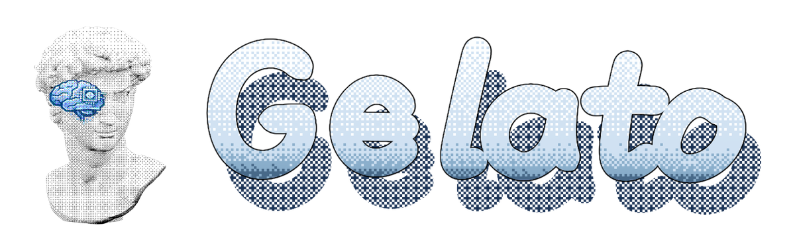
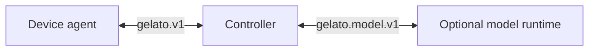

<p align="center">
  
</p>

<p align="center">
  
  <sub><strong>StreamingTelligence</strong></sub>
</p>

<p align="center">
  <a href="README.md">English</a> ｜ <a href="README.zh-CN.md">简体中文</a>
</p>

<p align="center">
  <strong>An open protocol and SDK stack that connects streaming intelligence to real-world devices.</strong>
</p>

Gelato is an ecosystem project of **StreamingTelligence Lab**. It lets phones, smart glasses, cameras, and other networked hardware become both sensors through which streaming intelligence perceives the world and environments in which it can respond to people and interact with the real world. A Controller manages identity, policy, routing, commands, media, and optional model integration, while each device advertises only the capabilities it actually has and retains final authority over what it executes.

Gelato v1 is the common protocol connecting these devices to a Controller. This repository provides the protocol specification, device and server SDKs, and a minimum viable implementation (MVP) for each supported device.

<p align="center">
  <a href="#demo">Watch the demo</a> ·
  <a href="#quick-start">Get started</a> ·
  <a href="docs/protocol.md">Read the protocol</a> ·
  <a href="docs/implementing-a-device.md">Add a device</a>
</p>

## Demo

https://github.com/user-attachments/assets/5811c155-1fd8-4fdc-9f51-a381bf7f0e6c

Watch the [Gelato demo (1:46, MP4)](docs/assets/gelato-demo-v7.mp4) to see wireless iPhone control, a kettle notification, and real-time assistance through Rokid glasses.

## Why Gelato

Gelato takes its name from Galatea, the statue brought to life in Greek mythology. In that spirit, the project aims to bring streaming intelligence to many kinds of devices and reshape how people interact with them.

- **Wireless interaction.** Pair and control Android phones, iPhones, and other devices over the network without depending on debugging cables. Gelato pairing and control require no physical connection.
- **Minimal intrusion.** Gelato is not limited to a device form factor and does not require expensive on-device compute or specialized hardware. Its open protocol can bring even a device with only a camera and Wi-Fi into a streaming-intelligence system; each device advertises only the capabilities it actually has.
- **Openness and privacy.** The device SDKs, server SDKs, and MVP for each supported device are open-source building blocks that let developers add new devices quickly. Gelato is not tied to any model provider, including StreamingTelligence. It can work locally without cloning a user's account information or working environment in the cloud, and model runtimes never receive device-pairing credentials.

See the [architecture](docs/architecture.md) for the complete system design.

## How it works



- **Device agent.** Checks local prerequisites, advertises capabilities, publishes instructions or observations, receives replies, and decides whether to execute routed commands.
- **Controller.** Handles pairing, device identity, authenticated sessions, state, policy, commands, cancellation, media streams, and optional model routing.
- **Model runtime.** Optionally turns device input into content or proposes an action through `gelato.model.v1`. An `action.propose` is only a proposal: the Controller routes it through the current device session, and the device retains execution authority.

Model inference is optional and remains separate from device pairing and control.

## Quick start

Run the Controller MVP with Node.js 22+:

```sh
npm ci
npm run build
npm start
```

Open `http://127.0.0.1:8090`. In another terminal, run `npm run token` and enter the generated token in the console. Create a one-use pairing link, then follow the setup guide for the device you want to connect.

A remote device needs a reachable HTTPS Controller with WebSocket upgrades; loopback HTTP is only for local development. See the full [getting-started walkthrough](docs/getting-started.md) and [Controller configuration guide](examples/server/control-room/README.md).

## Supported devices and MVPs

The following entries are implementations **in this repository**, not a claim that every capability is production-ready or available on every device. They share the Gelato v1 wire protocol while retaining platform-specific drivers, onboarding, and local authorization.

| Hardware | Capabilities | Where the device-side code runs | MVP code | Setup guide |
| --- | --- | --- | --- | --- |
| Android phone (Android 8+; Android 11+ for Wireless Debugging pairing) | Phone GUI control, camera and screen observation, voice assistant | On the phone | [`examples/device/android-app/`](examples/device/android-app/) | [Android](examples/device/android-app/README.md) |
| iPhone (iOS 27 for wireless pairing) | Phone GUI control, camera and screen observation, voice assistant | On the phone, with iOS extensions | [`examples/device/ios-app/`](examples/device/ios-app/) | [iOS](examples/device/ios-app/README.md) |
| Rokid BOLON glasses | 1 fps camera observation, microphone input, audio reply playback, and latest-frame capture | On the glasses; USB for first installation, Wi-Fi thereafter | [`examples/device/rokid-native-app/`](examples/device/rokid-native-app/) | [Rokid native](examples/device/rokid-native-app/README.md) |
| Seeed XIAO ESP32S3 Sense camera | Camera observation | On the headless board; USB installs firmware, Wi-Fi handles setup and pairing | [`device-sdk/esp32s3-xiao-camera/GelatoXiaoCamera/`](device-sdk/esp32s3-xiao-camera/GelatoXiaoCamera/) | [XIAO](device-sdk/esp32s3-xiao-camera/README.md) |

The companion Controller MVP is in [`examples/server/control-room/`](examples/server/control-room/). Device SDK implementations are in [`device-sdk/`](device-sdk/README.md), and reusable Controller code is in [`server-sdk/`](server-sdk/README.md). The XIAO implementation is board-specific firmware, not a generic ESP32 library.

## Supported model runtimes

A Controller can connect to a model runtime through the `gelato.model.v1` [model session specification](model_interface/protocol.md). Device inputs can become model input, and model content can become a device reply. The model runtime never receives device-pairing credentials.

The [`model_interface/`](model_interface/README.md) directory contains the protocol, schema, and provider-neutral Controller adapter. The [Controller MVP](examples/server/control-room/) supports the following integrations:

| Model runtime | How it is connected and what it supports | MVP implementation |
| --- | --- | --- |
| Qwen Live Harness | An in-process adapter uses the pinned `qwen-live-harness` package for text/PCM audio turns, live Rokid audio and 1 fps JPEG input, and audio replies. It does not propose device actions. | [`qwenLiveEndpoint.ts`](model_interface/src/qwenLiveEndpoint.ts) |
| Codex | An independent `gelato.model.v1` WebSocket endpoint drives Codex app-server for text/image turns and device-action proposals. It does not ingest audio or continuous 1 fps video. | [Codex model plugin](model_interface/gelato-codex-model/) |
| One-shot HTTP | A provider-neutral request/response adapter is available for bounded text or image turns. It does not implement a persistent `gelato.model.v1` session. | [`httpEndpoint.ts`](model_interface/src/httpEndpoint.ts) |

See the [model interface README](model_interface/README.md) for setup instructions and exact modality boundaries.

## Protocol and SDKs

The Gelato v1 device protocol is composed of the following contracts:

| Part | Contract |
| --- | --- |
| Local prerequisite checks | Device-specific, offline-capable checks and guidance before pairing and control |
| Pairing and session | One-use code, issued device identity and connection credential, authenticated reconnect |
| Connection and state | Device-initiated WebSocket, leases, presence, and capability snapshots |
| Input and reply | Device instructions/observations (`input.publish`) and server content replies (`reply.deliver`) |
| Control | Versioned `command.request`, progress, result/error, deadline, and cancellation |
| Media | Separate authenticated streams for binary data referenced by messages or results |

The wire identifier is `gelato.v1`. Read the [protocol specification](docs/protocol.md) for message rules, inspect the [JSON schemas](device-sdk/schemas/) for machine-readable contracts, and follow [Implement a device](docs/implementing-a-device.md) for the minimum device contract.

The repository includes:

- [Device SDKs](device-sdk/README.md) for device-side protocol and platform implementations.
- [Server SDKs](server-sdk/README.md) for reusable Controller-side pairing, routing, commands, media, and platform drivers.
- [Model interface](model_interface/README.md) for the provider-neutral model protocol, Qwen adapter, HTTP adapter, and Codex plugin.
- [Controller MVP](examples/server/control-room/) as a minimum working integration of the protocol, SDKs, supported devices, and optional model runtimes.

## Quality and testing

Required pull request checks protect the public device and model protocols, Controller behavior and security boundaries, Node.js SDKs, package exports, and local integration paths. They do not require service credentials, external APIs, or physical devices.

Run the same build and test sequence locally with:

```sh
npm run ci
```

The coverage gate applies to the explicitly maintained public path rather than presenting a repository-wide percentage. Physical-device validation remains a manual release check. See the [testing and pull request policy](docs/testing.md) for individual commands, coverage thresholds, protocol-fixture rules, CI requirements, and the manual device release record.

## Documentation and repository map

| Start here | For |
| --- | --- |
| [Documentation index](docs/README.md) | Reading path by role |
| [Getting started](docs/getting-started.md) | Local Controller and first device |
| [Architecture](docs/architecture.md) | Device side, Controller, and optional integrations |
| [Protocol specification](docs/protocol.md) and [JSON schemas](device-sdk/schemas/) | Gelato v1 wire and conformance rules |
| [Implement a device](docs/implementing-a-device.md) | Connect new hardware |
| [Device SDKs](device-sdk/README.md) and [server SDKs](server-sdk/README.md) | Source modules and platform-specific guides |
| [Model interface](model_interface/README.md) | Model protocol, Qwen adapter, HTTP adapter, and Codex plugin |
| [Testing and pull request policy](docs/testing.md) | Local checks, coverage gates, CI, and device release evidence |

The example Controller selects a model connection through `@gelato/model-interface`; see the [Controller configuration guide](examples/server/control-room/README.md).

## Contributing and license

See [CONTRIBUTING.md](CONTRIBUTING.md) for contribution requirements. Gelato is licensed under the [Apache License 2.0](LICENSE). Third-party components retain their own licenses.
