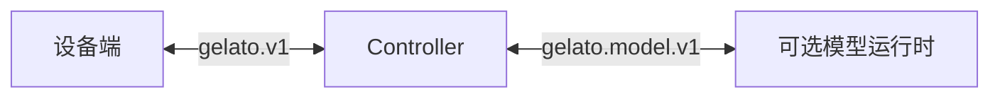

<p align="center">
  
</p>

<p align="center">
  
  <sub><strong>StreamingTelligence</strong></sub>
</p>

<p align="center">
  <a href="README.md">English</a> ｜ <a href="README.zh-CN.md">简体中文</a>
</p>

<p align="center">
  <strong>连接流式智能与真实世界设备的开放协议与 SDK 栈。</strong>
</p>

Gelato 是 **StreamingTelligence Lab 的生态支撑项目**。它让手机、智能眼镜、摄像头和其他联网硬件，既成为流式智能感知世界的传感器，也成为流式智能回应用户、与现实世界交互的环境。Controller 负责身份、策略、路由、命令、媒体和可选模型集成；每台设备只声明自己实际具备的能力，并保留最终执行权。

Gelato v1 是连接这些设备与 Controller 的统一协议。本仓库提供协议规范、设备端和服务端 SDK，以及各类已支持设备的最小可行实现（MVP）。

<p align="center">
  <a href="#演示视频">观看演示</a> ·
  <a href="#快速开始">快速开始</a> ·
  <a href="docs/protocol.zh-CN.md">阅读协议</a> ·
  <a href="docs/implementing-a-device.zh-CN.md">接入设备</a>
</p>

## 演示视频

https://github.com/user-attachments/assets/5811c155-1fd8-4fdc-9f51-a381bf7f0e6c

观看 [Gelato 演示（1 分 46 秒，MP4）](docs/assets/gelato-demo-v7.mp4)，了解 iPhone 无线控制、水壶提醒，以及通过 Rokid 眼镜提供的实时辅助。

## 为什么选择 Gelato

Gelato 的名字源于希腊神话中被赋予生命的雕像 Galatea。正如其名，这个项目希望把流式智能带到各种设备中，重塑人与设备的交互方式。

- **无线交互。** 摆脱对调试线的依赖，让 Android、iOS 手机和其他设备通过网络完成配对与控制。Gelato 配对和控制不依赖物理连接。
- **最小侵入性。** Gelato 不限定设备形态，也不要求昂贵的端侧算力或特殊硬件。通过开放协议，即使设备只有摄像头和 Wi-Fi，也能接入流式智能系统；每台设备只声明自己实际具备的能力。
- **开放性和隐私性。** 设备端 SDK、服务端 SDK 以及各类已支持设备的 MVP 都是开源构件，让开发者能够快速接入新设备。Gelato 不绑定任何模型厂商，包括 StreamingTelligence。它可以在本地工作，无需在云端克隆用户的账号信息或本地工作环境；模型运行时也不会获得设备配对凭据。

完整系统设计见[架构说明](docs/architecture.zh-CN.md)。

## 工作原理



- **设备端。** 检查本地前置条件、声明能力、发布指令或观察信息、接收回复，并决定是否执行路由而来的命令。
- **Controller。** 负责配对、设备身份、认证会话、状态、策略、命令、取消、媒体流以及可选的模型路由。
- **模型运行时。** 可以通过 `gelato.model.v1` 将设备输入转为内容，或提出操作建议。`action.propose` 仅是提议：Controller 会通过当前设备会话进行路由，最终执行权仍保留在设备端。

模型推理是可选能力，并始终与设备配对和控制相互分离。

## 快速开始

使用 Node.js 22+ 运行 Controller MVP：

```sh
npm ci
npm run build
npm start
```

打开 `http://127.0.0.1:8090`。另开一个终端运行 `npm run token`，然后在控制台中输入生成的令牌。创建一次性配对链接，再按照目标设备的配置指南完成连接。

远程设备需要一个可访问、支持 WebSocket 升级的 HTTPS Controller；回环 HTTP 仅用于本地开发。完整步骤见[快速开始指南](docs/getting-started.zh-CN.md)和[服务端示例](examples/server/control-room/README.md)。

## 已支持的硬件与 MVP 位置

下表列出的是**本仓库中的实现**，并不代表所有能力都已达到生产可用状态，也不代表每台设备都具备全部能力。它们共用 Gelato v1 线上协议，同时保留针对各平台的驱动、首次配置和本地授权流程。

| 硬件 | 能力 | 设备端代码运行位置 | MVP 代码 | 配置指南 |
| --- | --- | --- | --- | --- |
| Android 手机（Android 8+；无线调试配对需要 Android 11+） | 手机 GUI 自动控制、观察摄像头、观察屏幕、语音助手 | 手机端 | [`examples/device/android-app/`](examples/device/android-app/) | [Android](examples/device/android-app/README.md) |
| iPhone（无线配对需要 iOS 27） | 手机 GUI 自动控制、观察摄像头、观察屏幕、语音助手 | 手机端，通过 iOS 扩展实现 | [`examples/device/ios-app/`](examples/device/ios-app/) | [iOS](examples/device/ios-app/README.md) |
| Rokid BOLON 眼镜 | 每秒一帧摄像头画面、麦克风输入、音频回复播放和最近一帧拍照 | 眼镜端；首次安装使用 USB，之后通过 Wi-Fi 连接 | [`examples/device/rokid-native-app/`](examples/device/rokid-native-app/) | [Rokid 原生安装与配对](examples/device/rokid-native-app/README.zh-CN.md) |
| Seeed XIAO ESP32S3 Sense 摄像头 | 观察摄像头 | 无屏开发板；通过 USB 安装固件，使用 Wi-Fi 完成设置和配对 | [`device-sdk/esp32s3-xiao-camera/GelatoXiaoCamera/`](device-sdk/esp32s3-xiao-camera/GelatoXiaoCamera/) | [XIAO](device-sdk/esp32s3-xiao-camera/README.md) |

配套的 Controller MVP 位于 [`examples/server/control-room/`](examples/server/control-room/)。设备 SDK 实现在 [`device-sdk/`](device-sdk/README.md)，可复用的 Controller 代码位于 [`server-sdk/`](server-sdk/README.md)。XIAO 实现是针对特定开发板的固件，并不是通用 ESP32 库。

## 已支持的模型端

Controller 可以通过 `gelato.model.v1` [模型会话规范](model_interface/protocol.zh-CN.md)连接模型运行时。设备输入可以成为模型输入，模型内容可以成为设备回复。模型运行时不会获得设备配对凭据。

[`model_interface/`](model_interface/README.zh-CN.md) 目录包含协议、Schema 和不绑定模型厂商的 Controller 侧适配器。[Controller MVP](examples/server/control-room/) 支持以下集成：

| 模型端 | 接入方式与支持能力 | MVP 实现 |
| --- | --- | --- |
| StreamingTelligence | 进程内适配器通过 WSS 连接原生流式 mux，支持文字提问与持续 JPEG 画面输入；不提出设备操作建议，也不返回音频。 | [`streamingTelligenceEndpoint.ts`](model_interface/src/streamingTelligenceEndpoint.ts) |
| Qwen Live Harness | 进程内适配器使用固定版本的 `qwen-live-harness` 包，支持文字／PCM 音频回合、Rokid 实时音频与每秒一帧 JPEG 输入，以及音频回复；不提出设备操作建议。 | [`qwenLiveEndpoint.ts`](model_interface/src/qwenLiveEndpoint.ts) |
| Codex | 独立的 `gelato.model.v1` WebSocket 模型端通过 Codex app-server 处理文字／图像回合和设备操作建议；不接收音频或持续的每秒一帧视频。 | [Codex 模型端插件](model_interface/gelato-codex-model/) |
| 一次性 HTTP | 不绑定模型厂商的请求／响应适配器，可用于有大小限制的文字或图像回合；它不实现持续的 `gelato.model.v1` 会话。 | [`httpEndpoint.ts`](model_interface/src/httpEndpoint.ts) |

配置方法和准确的模态边界见[模型端目录说明](model_interface/README.zh-CN.md)。

## 协议与 SDK

Gelato v1 设备协议由以下契约组成：

| 部分 | 契约 |
| --- | --- |
| 本地前置条件检查 | 配对和控制前，针对具体设备、可离线执行的检查与引导 |
| 配对与会话 | 一次性配对码、签发的设备身份与连接凭据、认证后的重新连接 |
| 连接与状态 | 设备主动建立 WebSocket 连接、租约、在线状态与能力快照 |
| 输入与回复 | 设备指令／观察信息（`input.publish`）和服务端内容回复（`reply.deliver`） |
| 控制 | 带版本的 `command.request`、进度、结果／错误、截止时间和取消 |
| 媒体 | 独立的认证媒体流，用于传输消息或结果中引用的二进制数据 |

线上标识为 `gelato.v1`。报文规则见[协议规范](docs/protocol.zh-CN.md)，机器可读契约见 [JSON Schema](device-sdk/schemas/)，最低设备实现要求见[实现一个设备](docs/implementing-a-device.zh-CN.md)。

本仓库包括：

- [设备 SDK](device-sdk/README.md)：设备端协议与平台实现。
- [服务端 SDK](server-sdk/README.md)：可复用的 Controller 侧配对、路由、命令、媒体及平台驱动。
- [模型端接口](model_interface/README.zh-CN.md)：不绑定模型厂商的模型协议、Qwen 适配器、HTTP 适配器和 Codex 插件。
- [Controller MVP](examples/server/control-room/)：协议、SDK、已支持设备和可选模型运行时的最小可工作集成。

## 质量与测试

PR 必须通过的检查覆盖公开的设备与模型协议、Controller 行为与安全边界、Node.js SDK、包导出以及本地集成路径。这些检查不需要服务凭据、外部 API 或物理设备。

在本地运行相同的构建与测试流程：

```sh
npm run ci
```

覆盖率门槛只针对明确维护的公共路径，而不是提供一个仓库整体覆盖率数字。真实设备验证仍然是手动发布检查。各项命令、覆盖率门槛、协议 Fixture 规则、CI 要求和手动设备发布记录见[测试与 PR 规范](docs/testing.md)。

## 文档与仓库导航

| 从这里开始 | 适用场景 |
| --- | --- |
| [文档索引](docs/README.zh-CN.md) | 按阅读目标找到文档 |
| [快速开始](docs/getting-started.zh-CN.md) | 本地 Controller 与第一台设备 |
| [架构说明](docs/architecture.zh-CN.md) | 设备端、Controller 与可选集成 |
| [协议规范](docs/protocol.zh-CN.md)和 [JSON Schema](device-sdk/schemas/) | Gelato v1 报文和符合性要求 |
| [实现一个设备](docs/implementing-a-device.zh-CN.md) | 接入新硬件 |
| [设备 SDK](device-sdk/README.md)和[服务端 SDK](server-sdk/README.md) | 源码模块和平台指南 |
| [模型端接口](model_interface/README.zh-CN.md) | 模型协议、Qwen 适配器、HTTP 适配器和 Codex 插件 |
| [测试与 PR 规范](docs/testing.md) | 本地检查、覆盖率门槛、CI 与设备发布证据 |

示例 Controller 通过 `@gelato/model-interface` 选择模型连接；配置见[服务端示例](examples/server/control-room/README.md)。

## 贡献与许可

贡献说明见 [CONTRIBUTING.md](CONTRIBUTING.md)。Gelato 采用 [Apache License 2.0](LICENSE) 开源；第三方组件仍遵循各自的许可证。
