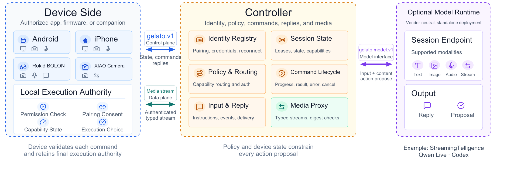

# Architecture

[简体中文](architecture.zh-CN.md)

Gelato is StreamingTelligence Lab's foundation for bringing streaming intelligence to many kinds of devices. Device-side `gelato.v1` has two parties: the device implementation invokes its local hardware or platform capabilities, while a Controller handles pairing, connections, commands, and media. An optional model runtime attaches through a separate `gelato.model.v1` session interface; account services are outside both protocols. The protocol does not require the device side to be split into separate processes or components.

  

## Roles and trust boundaries

| Role | Responsibility |
| --- | --- |
| Device owner and local UI | Permission requests, first-pairing confirmation, connection and remote-control consent |
| Device-side implementation | One-use pairing, credential storage, outbound connection, snapshots, input/reply and command lifecycle, and local hardware or platform capability execution |
| Controller | Device-connection authentication, device registry, capability-aware command routing, replies, and typed media streams |

The Rokid BOLON reference implementation runs **on the glasses**. A USB debugging connection commissions the headless app and passes a one-time pairing link; the app then connects directly to the Controller over Wi-Fi and captures camera frames locally. The Controller sees `rokid.bolon` with a device-local driver. The XIAO camera implementation also runs **on the board itself**, but uses a temporary local Wi-Fi page for first setup. Each has its own device identity in the Controller. See the [Rokid native example](../examples/device/rokid-native-app/README.md) and [XIAO](../device-sdk/esp32s3-xiao-camera/README.md) guides.

## Three independent device choices

| Choice | Effect |
| --- | --- |
| Paired | The device has an issued identity and credential. This persists until revocation or explicit reset. |
| Connection enabled | The device side may initiate the authenticated Controller connection. Disabling it closes the connection without deleting the pairing. |
| Control allowed | The owner permits advertised commands and control media. Disabling it keeps pairing and presence but rejects commands other than `device.describe`. |

These are protocol states, not just labels in a Controller UI. Local permission checks and capability readiness remain separate: a paired device may be connected while its camera capability is unavailable.

## Data paths

1. **Pairing and presence:** a user reviews local prerequisite checks; the device side sends `pairing.request` using a one-use code; later sessions use `session.hello`. It sends a fresh snapshot and renews its lease.
2. **Conversation:** a device sends `input.publish` with an instruction or observation. The Controller may deliver content with `reply.deliver`; the device acknowledges receipt. A reply is never an executable command.
3. **Control:** the Controller sends `command.request` for a versioned capability in the current snapshot. The device returns one terminal result or error. How the device performs the operation is outside the base protocol.
4. **Media:** binary data travels on an authenticated typed stream and is referenced by an input or command result. Stream size and digest are verified independently of the control message.
5. **Model session (optional):** the Controller forwards input to a persistent model session and receives incremental and final replies. A model may propose an action but cannot bypass Controller and device-side authorization. See the [model interface](../model_interface/README.md) and its [session specification](../model_interface/protocol.md).

For exact message fields and lifecycle rules, use the [specification](protocol.md). For source code, start with the [device SDKs](../device-sdk/README.md) and [server SDKs](../server-sdk/README.md).
