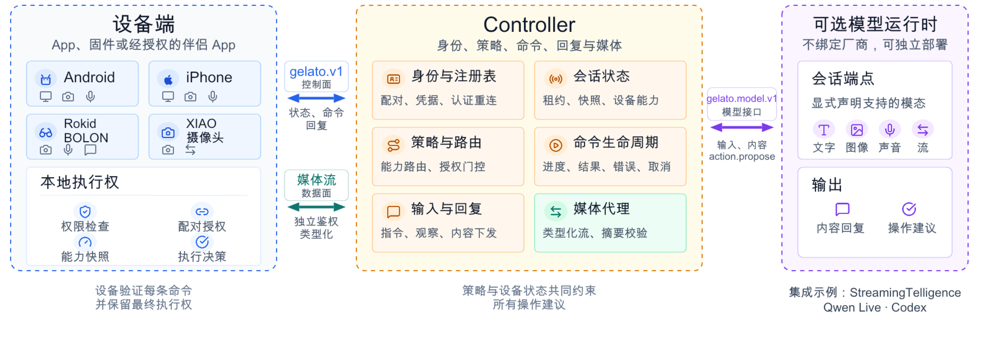

# 架构说明

[English](architecture.md)

Gelato 是 StreamingTelligence Lab 将流式智能带到不同设备的基础设施。设备侧 `gelato.v1` 的两端是设备端与 Controller：设备端通过本地实现调用实际硬件或平台能力；Controller 管理配对、连接、命令和媒体。可选的模型运行时通过独立的 `gelato.model.v1` 会话接口接入 Controller；账号服务不属于这两个协议。协议不要求设备端拆成多个进程或组件。

  

## 角色与信任边界

| 角色 | 负责 |
| --- | --- |
| 设备所有者与本地界面 | 权限申请、首次配对确认、连接和远程控制授权 |
| 设备端实现 | 一次性配对、凭据保存、主动连接、快照、输入／回复和命令生命周期；调用本地硬件或平台能力 |
| Controller | 设备连接鉴权、设备注册、按能力路由命令、回复和类型化媒体流 |

Rokid BOLON 参考实现**直接运行在眼镜上**：首次通过 USB 调试安装无屏幕应用并传入一次性配对链接，之后应用通过 Wi-Fi 直连 Controller，并在眼镜本机采集摄像头画面。Controller 看到的设备是 `rokid.bolon`，驱动也在设备本机。XIAO 摄像头设备端同样**直接运行在开发板上**，但首次配置使用临时本地 Wi-Fi 页面。每个设备在 Controller 中有自己的身份。参见 [Rokid 原生端](../examples/device/rokid-native-app/README.zh-CN.md)和 [XIAO](../device-sdk/esp32s3-xiao-camera/README.md) 指南。

## 设备上的三个独立选择

| 选择 | 效果 |
| --- | --- |
| 已配对 | 设备获得身份与凭据；除非撤销或显式重置，否则会保留。 |
| 开启连接 | 设备端可以主动建立经过鉴权的 Controller 连接；关闭连接不会删除配对。 |
| 允许控制 | 所有者允许已声明的命令与控制媒体；关闭后保留配对和在线状态，但拒绝 `device.describe` 以外的命令。 |

这些是协议状态，不只是控制端界面上的标签。本地权限检查与能力就绪状态仍然独立：设备可以已配对、已连接，但摄像头能力暂时不可用。

## 数据路径

1. **配对与在线状态：** 用户完成本地准备；设备端用一次性码发送 `pairing.request`，后续会话使用 `session.hello`。设备端发送新快照并续租。
2. **对话：** 设备通过 `input.publish` 发送指令或观察信息。Controller 可用 `reply.deliver` 下发内容，设备确认收到。回复不是可执行命令。
3. **控制：** Controller 仅针对当前快照声明的、带版本号的能力发送 `command.request`。设备返回一个最终结果或错误。具体操作如何在设备本地实现，不由基础协议规定。
4. **媒体：** 二进制数据通过独立鉴权的类型化流传输，再由输入或命令结果引用。流的字节数和摘要与控制消息分开校验。
5. **模型会话（可选）：** Controller 将输入送到持续的模型会话，接收增量及最终回复；模型只能提出操作，不能绕过 Controller 和设备端授权直接控制硬件。见[模型端接口](../model_interface/README.zh-CN.md)及其[会话规范](../model_interface/protocol.zh-CN.md)。

报文字段与生命周期规则见[协议规范](protocol.zh-CN.md)；源码入口见[设备 SDK](../device-sdk/README.md)和[服务端 SDK](../server-sdk/README.md)。
